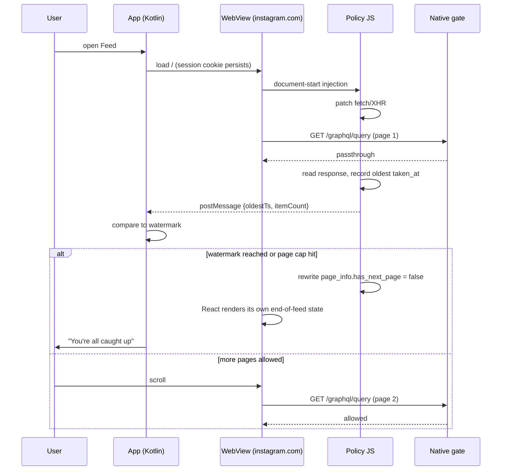

# SimpleInsta — a finite Instagram client for Android

**Status:** design plan (no implementation)
**Working title:** `SimpleInsta` · package `app.simpleinsta.ig`
**Date:** 2026-10-28

> **Implemented.** See `README.md` for what was actually built, how to run it, and the six places
> where implementation diverged from this plan (§6.1's native gate is not implementable as written —
> GraphQL pagination is a POST and request bodies are unreadable in `shouldInterceptRequest`).

---

## 0. TL;DR

Android has no real "app extension" model. There are only three ways to change how Instagram behaves:
hook it at runtime, rebuild it, or replace it. Hooking and rebuilding both fight an obfuscated,
version-pinned binary that ships every two weeks. Replacing the *client surface* while keeping the
*session* is the only approach that is small, stable, and fully controllable.

**Recommendation:** a ~3 MB WebView shell that loads `instagram.com` with a document-start injected
**policy engine**. The engine does three things:

1. **Caps the feed at the data layer** — it rewrites pagination metadata so the client believes there
   is no next page. Instagram's own React app then renders its own "You're all caught up" state and
   stops asking for more. No CSS tricks, no scroll hacks.
2. **Deletes the Reels surface entirely** — `/reels` never mounts.
3. **Turns DM-sent reels into a finite playlist** — the app reads reel payloads out of DM thread
   JSON and plays them in a minimal native player with *Next / Prev buttons and no vertical swipe*.
   When the queue is empty: a full-screen "You are all caught up."

The key idea is not "block scrolling." It is **stop being a stream**. Instagram's feed and Reels are
infinite because the client keeps asking for more; if the client never asks, the product is finite by
construction. Blocking a gesture is a losing fight against a pager; removing the data source is a
one-line invariant.

Everything below is designed to survive Instagram shipping a new build next Tuesday.

---

## 1. Problem & success criteria

### 1.1 The four requirements

| # | Requirement | Precise meaning |
|---|---|---|
| R1 | Feed shows only people I follow | No ads, no "suggested for you", no "because you follow X", no Explore content. Author must be in my following set. |
| R2 | Messages work normally | Read, reply, react, open threads. DMs are not degraded. |
| R3 | Reels only from DMs, and they end | The only reels reachable are ones a human deliberately sent me. After the last one, there is no next. |
| R4 | Terminal "all caught up" state | When the finite set is exhausted, an explicit end screen. No "keep scrolling" affordance anywhere. |

Plus non-functional: simple, lightweight, no crashes, no battery drain, no complicated UI.

### 1.2 Acceptance tests

These are the tests that decide whether the project succeeded. They are behavioral, not technical.

- **AT1** — Open the app, scroll the feed to the bottom. It stops. A "You're all caught up" state is
  visible. Pull-to-refresh does not produce new posts beyond the watermark.
- **AT2** — No item in the feed has an author outside the following set. Verified over 3 sessions and
  a fresh login.
- **AT3** — Send yourself / receive a reel in DM. It appears in the Reels queue. Play it. Press Next.
  Play the last one. The screen says "You are all caught up" and offers no next.
- **AT4** — With an empty queue, tapping the Reels entry point never opens a vertical feed.
- **AT5** — Swiping up anywhere in the app never reveals an algorithmic reel.
- **AT6** — Cold start < 1.5 s on a mid-range device; idle RAM < 250 MB; no measurable battery drain
  when backgrounded (process is not running).
- **AT7** — Kill the network mid-session: app does not crash, shows a retry state.
- **AT8** — Instagram ships a new web build: app degrades to "Reels hidden, feed uncapped" rather
  than crashing or showing a blank page.

### 1.3 Non-goals

- Posting, stories, live, shopping, notes, threads.
- Multi-account switching (v1: one account).
- Push notifications for DMs (see §13, deferred).
- Working around Instagram's rate limits or bans.
- Any Play Store distribution (see §12.3).

---

## 2. Research: what already exists

I looked for prior art before designing. Five clusters are relevant, and the gap between them is the
whole reason this project exists.

### 2.1 Prior art

| Project | Type | Stack | Traction | What it proves |
|---|---|---|---|---|
| [`brosssh/morphe-patches`](https://github.com/brosssh/morphe-patches) | ReVanced/Morphe patch set | Kotlin, DEX patching | ~350★, active | The exact features are *already written* as APK patches: `Disable Reels scrolling`, `Limit feed to following profiles`, `Hide navigation buttons`, `Hide explore feed`, `Hide suggested content`. |
| [`ReSo7200/InstaEclipse`](https://github.com/ReSo7200/InstaEclipse) | Xposed module | Java + DexKit | ~1.6k★, very active | Runtime hooking is viable at scale. Has `Lock Reels scrolling` and `Following only feed`. Uses **DexKit** to resolve obfuscated methods by structure, so it survives IG updates. |
| [`AlexMatter1512/justagram`](https://github.com/AlexMatter1512/justagram) | WebView wrapper | Capacitor + TS | ~68★, active | A WebView shell is good enough for daily use. Injects CSS rules per surface (`hideReels.css`, `dmOnlyMode.css`, `hideExplore.css`). Has a **DM-only mode** already. |
| [`matom664/InstaDm`](https://github.com/matom664/InstaDm) | WebView wrapper | Kotlin + Compose + AndroidX WebKit | new | The reference architecture for this plan: URL filtering in `shouldOverrideUrlLoading` + `doUpdateVisitedHistory`, plus JS reinforcement. Explicitly avoids private APIs and cookie extraction. |
| [`ReSo7200`-adjacent / Barinsta](https://fossdroid.com/a/instagrabber-2.html) | Third-party API client | Java | dead (2021) | **What not to do.** Barinsta used Instagram's private API for reading; it was discontinued after legal pressure from Meta. Private-API clients are both fragile and legally exposed. |
| [`mouwaficbdr/caught-up`](https://github.com/mouwaficbdr/caught-up) | Concept reference | TypeScript | small | Replaces YouTube's algorithmic home feed with a finite view of subscriptions only. Same product thesis, different platform — useful for copy and UX framing. |
| `Play Store: Block Scroll / Undoomed` | Friction apps | closed | commercial | The market exists, but these are *friction* products (interstitials, timers), not *shape* products. They slow the scroll; they don't remove it. |

### 2.2 What each approach actually fails at

**APK patching (`morphe-patches`)** gets closest to the feature list, but:
- It is pinned to one Instagram build (currently `439.0.0.37.89`). Every IG release needs re-patching
  and re-testing against moved obfuscated symbols.
- It requires signature bypass and a cloned package name, which means **Play Integrity fails** — and
  on many phones that breaks banking apps, Google Wallet, and some games. That is a much bigger
  blast radius than "I scroll too much."
- `Disable Reels scrolling` stops you swiping to the *next* reel. It does not build a queue, does not
  distinguish DM-sent reels from algorithmic ones, and has no terminal state. It is a brake, not a
  shape.

**Xposed (`InstaEclipse`)** is the most impressive engineering of the three, and DexKit genuinely
solves the version-drift problem. But:
- Requires root, or **LSPatch** — which repackages the APK, so you are back to signature-bypass
  consequences.
- Hooking a 200 MB obfuscated app means chasing internal class graphs forever. The feature list is
  enormous precisely because each hook is a small, brittle negotiation with Meta's code.
- Still no DM-reel queue, still no "caught up" state.

**Accessibility service on the official app** looks appealing (no root, no repackaging) but is the
worst of the options in practice:
- You cannot reliably stop a `ViewPager2`/`RecyclerView` from scrolling. You can overlay a window and
  swallow touches (`TYPE_ACCESSIBILITY_OVERLAY`), but you are racing the app's own gesture handling,
  and a fast fling gets through.
- Instagram's resource IDs are obfuscated and change between builds; node-tree matching is fragile.
- The service must be alive whenever IG is open, which means a persistent process — the opposite of
  "lightweight."
- Google Play prohibits accessibility APIs for non-accessibility purposes; sideloading only.

**Private API client (Barinsta)** is the trap. Reading DMs via `direct_v2` endpoints gives you perfect
control and gets accounts banned. It also died to legal pressure. Not a foundation.

### 2.3 The gap

Every existing project either **brakes** an infinite feed or **hides** a surface. None of them
**redefine the set**. Concretely, nobody has built:

- a queue of exactly the reels that humans sent you, playable without entering Instagram's Reels UI;
- a feed that ends at a watermark ("everything since your last visit") instead of at a page limit;
- a terminal state that is a *product surface*, not an absence.

That is the entire delta, and it is small — which is why this is a weekend-scale app rather than a
reverse-engineering project.

---

## 3. Architectures considered

### 3.1 Comparison

Scores: 1 = bad, 5 = good.

| | A. APK patch | B. Xposed module | C. Accessibility guard | **D. WebView client** | E. DNS/timer |
|---|---|---|---|---|---|
| Effort to first working build | 2 | 2 | 3 | **4** | 5 |
| Survives IG updates | 1 | 3 | 2 | **4** | 5 |
| Account risk | 3 | 4 | 5 | **4** | 5 |
| Battery / RAM | 5 | 5 | 3 | **4** | 5 |
| No root, no repackaging | 2 | 1 | 5 | **5** | 5 |
| Can express R3 (DM reel queue) | 2 | 2 | 1 | **5** | 1 |
| Can express R4 (terminal state) | 2 | 2 | 3 | **5** | 1 |
| Blast radius if it breaks | 2 | 2 | 4 | **5** | 5 |
| **Total** | 19 | 20 | 26 | **36** | 32 |

Option E scores well on safety but simply cannot do R3/R4 — a DNS or VPN blocker sees one hostname,
not a surface. It cannot separate "reel a friend sent me" from "reel the algorithm chose."

### 3.2 Decision

**Option D: WebView client with a document-start policy engine.**

Rationale, in priority order:

1. **It owns the data path.** The single most reliable way to make a feed finite is to stop the
   client from requesting page N+1. In a WebView we can do that at the network layer, where the
   decision is a boolean, instead of at the gesture layer, where the decision is a race.
2. **Failure is contained.** A broken selector hides nothing. A broken native hook crashes Instagram.
   For an app whose purpose is to reduce anxiety, "sometimes shows a suggested post" is an acceptable
   failure; "bootloops your phone" is not.
3. **No root, no signature bypass, no Play Integrity fallout.** The app is a browser. It does not
   touch `com.instagram.android`.
4. **It is genuinely small.** ~3 MB APK, one Activity, one WebView, one ExoPlayer. Nothing runs in
   the background.
5. **Repair is remote.** Policies are data (JSON + JS), not code. A DOM change can be fixed by
   shipping a new policy bundle, not a new APK.

The cost we accept: web Instagram is slower than native, some features are missing (camera, voice
notes, story upload), and push notifications do not exist. None of those matter for this goal —
arguably the missing camera is a feature.

### 3.3 Why not "just use the Following feed"

Worth stating, because it is the honest baseline: Instagram already has a chronological **Following**
feed and an app timer in Digital Wellbeing. Someone could get 60% of R1 and 0% of R3/R4 for free.

This plan is justified only if the DM-reel queue matters — which, per the brief, it does. If a
30-minute daily timer plus the Following tab is acceptable, build nothing. I include this so the
decision is explicit rather than assumed.

---

## 4. Product model: an inbox, not a stream

### 4.1 The reframe

Instagram is designed as a **stream**: unbounded, ranked, always more. The app is an **inbox**:
bounded, chronological, drains to empty, and tells you when it's done.

That single metaphor generates every rule in the product.

| Stream behavior | Inbox behavior |
|---|---|
| Scroll until you stop | Scroll until it's empty |
| The algorithm decides what's next | Other humans decide what's in it |
| "More" is always available | "Done" is a reachable state |
| Time is the input | Items are the input |

### 4.2 Three surfaces, one of which does not exist

```
┌──────────────────────────────────────────────────────┐
│                                                      │
│   Feed            Messages             Queue         │
│   ────            ────────             ─────         │
│   posts from      real DMs,            reels that    │
│   people you      fully                humans sent   │
│   follow,         functional           you           │
│   finite                                             │
│                                                      │
│   no Explore · no Reels tab · no Stories tray        │
│                                                      │
└──────────────────────────────────────────────────────┘
```

- **Feed** — Instagram's own web feed, with pagination capped and suggested content stripped.
- **Messages** — Instagram's own web DM, untouched. This is the one place where "just use their UI"
  is correct, because DMs are already finite and human-driven.
- **Queue** — native. Not Instagram's Reels viewer. A deliberate, button-driven playlist.

There is no fourth tab, no Explore, no search grid, no stories tray. Removing entry points is cheaper
and more reliable than policing them.

### 4.3 Budgets and the state machine

Two independent finite sets, each with its own terminal state.

```
FEED
  IDLE ──open──► LOADING ──items──► SCROLLING ──watermark hit──► CAUGHT_UP
                     │                   │                          │
                     └──error──► RETRY   └──page cap──► CAUGHT_UP    └──new post──► SCROLLING
                                                                        (on next open)

QUEUE
  EMPTY ──sync finds unplayed──► READY ──play──► PLAYING ──next──► PLAYING
                                   ▲                │
                                   │                └──last item──► DRAINED
                                   └──new reel sent───────────────────┘
```

**Feed watermark rule.** Store `lastFeedVisitAt` (epoch). Pagination stops when either:
(a) the oldest item on the page has `taken_at < lastFeedVisitAt`, or
(b) `pagesFetched >= feedPageCap` (default 2, safety valve).
Whichever fires first ends the feed. On next open, `lastFeedVisitAt` is only advanced if the feed
reached `CAUGHT_UP` — so an interrupted session does not silently swallow posts.

**Queue rule.** The queue is the set of reel-type DM items that are (i) sent by someone else,
(ii) not locally marked played, (iii) younger than `queueMaxAgeDays` (default 14). It is not a
recommendation list; it cannot grow on its own. Only a human sending a reel adds to it.

**Why a watermark instead of a count.** A fixed "20 posts per day" is arbitrary and feels punitive.
"Everything since you last looked" is a real, defensible boundary — it is what a sane notification
system would give you — and it naturally adapts: busy week, longer feed; quiet week, shorter feed.

---

## 5. Architecture

### 5.1 Modules

```
app/
├── ui/                    Jetpack Compose, 3 screens + 1 overlay
│   ├── FeedScreen.kt      hosts the WebView
│   ├── MessagesScreen.kt  hosts the same WebView (different URL)
│   ├── QueueScreen.kt     native player
│   └── CaughtUpOverlay.kt terminal state
├── web/
│   ├── WebViewHost.kt     single instance, lifecycle, back handling
│   ├── UrlPolicy.kt       allow/deny/redirect table (native, unbypassable)
│   ├── RequestGate.kt     shouldInterceptRequest: pagination kill switch
│   └── Bridge.kt          addWebMessageListener <-> Kotlin
├── policy/
│   ├── PolicyBundle.kt    loads bundled JS + optional remote override
│   ├── InjectedScript.kt  assembled from parts, injected at document start
│   └── js/
│       ├── 00_runtime.js     fetch/XHR patch, structural walkers
│       ├── 10_feed.js        watermark + suggested strip
│       ├── 20_dm.js          thread scan -> reel queue extraction
│       ├── 30_dom.js         nav hiding, sentinel removal
│       └── 90_health.js      selector assertions, degrade signal
├── queue/
│   ├── ReelQueueRepository.kt
│   └── Player.kt          Media3 ExoPlayer, single instance
└── data/
    ├── AppDatabase.kt     Room: queue_item, seen_media, session_state
    └── Prefs.kt           DataStore: watermark, caps, account id
```

~15 source files. No DI framework, no navigation library, no analytics SDK. Compose + Room + Media3 +
AndroidX WebKit. That is the entire dependency list, and it is deliberate: every extra SDK is a
startup cost and a crash surface.

### 5.2 Runtime flow



Note the division of labour: **JS decides, Kotlin enforces.** The JS layer is where the logic is
readable and remotely fixable; the native layer is where the guarantee lives, because page requests
can be refused before they leave the device.

### 5.3 Lifecycle rules

These are the rules that keep the app from being a battery problem.

- **One WebView, ever.** Created once in `FeedScreen`, detached and re-attached when switching tabs.
  Never `loadUrl` on tab switch — use `evaluateJavascript("history.pushState(...)")` or SPA-internal
  navigation. Recreating a WebView costs 300–800 ms and re-renders the React tree.
- **No service.** No foreground service, no accessibility service, no `WorkManager` in v1. When the
  Activity stops, the process is eligible for death, and that is correct.
- **One ExoPlayer.** Created on `QueueScreen` entry, released in `onStop`. `setMediaItem` between
  reels instead of recreating.
- **`onTrimMemory` → drop caches, clear WebView cache if `TRIM_MEMORY_COMPLETE`.**
- **`onRenderProcessGone` → recreate the WebView once, restore URL from DataStore.** WebView renderer
  crashes are the #1 cause of "app crashed" reports in wrapper apps, and they are recoverable.

---

## 6. The policy engine

This is the part that has to be right, because it is the part Instagram will try to break.

### 6.1 Layer 1 — network (the real lever)

Instagram's web client is React + Relay. Every "load more" is a POST to `/graphql/query` (doc_id
based) or `/api/graphql`, carrying a cursor in `variables.after`. The response contains a connection
object with `page_info { has_next_page, end_cursor }`.

Relay's `usePaginationFragment` derives `hasNext` from `pageInfo.hasNextPage`. **Set it to `false` and
`loadNext()` becomes a no-op.** The infinite scroll dies without touching the DOM.

Two implementations, used together:

**Tier 1 — JS response rewrite (smooth).** Monkey-patch `window.fetch` and
`XMLHttpRequest.prototype.send` at document start, before Instagram's bundle runs. After the response
resolves, walk the JSON for *any* object shaped like:

```js
{ edges: [...], page_info: { has_next_page: true, end_cursor: "..." } }
```

and flip `has_next_page` to `false`, null `end_cursor`. Because the walk is structural, it does not
matter what the query is called, which doc_id is used, or where in the tree the connection sits. This
is the single most important robustness decision in the design: **never match on query names.**

**Tier 2 — native gate (enforcement).** `shouldInterceptRequest` counts paginated feed requests per
session. Once the budget is spent, return a synthetic empty connection instead of forwarding. This
survives the JS layer being broken entirely.

```kotlin
// RequestGate.kt — sketch
override fun shouldInterceptRequest(view: WebView, req: WebResourceRequest): WebResourceResponse? {
    if (!isFeedPagination(req)) return null
    if (budget.spent()) return emptyFeedConnection()
    budget.consume()
    return null // passthrough
}
```

`isFeedPagination` matches on the *presence of a cursor parameter*, not on a URL constant — so it
keeps working when Meta renames endpoints.

**Tier 3 — scroll sentinel removal (cosmetic).** If Instagram still renders a "loading" spinner at the
bottom because it thinks more is coming, remove the sentinel node and set
`document.body.style.overflow = "hidden"` on the feed container. Cosmetic only; never load-bearing.

### 6.2 Layer 1b — filtering to followed accounts (R1)

Three candidate mechanisms, in order of preference:

1. **Prefer Instagram's own Following tab.** If the web build exposes a following-only variant
   (a `variant=following` parameter or a tab in the home header), navigate to it. Zero filtering code,
   maximum fidelity. This must be verified in Spike 0 and is the first choice if it works.
2. **Structural strip.** Drop any feed item that carries a monetization or recommendation marker —
   `ad_id`, `is_suggested`, `social_context`, `explore_story`, `injected`, `brs_severity` — or whose
   `user.pk` is absent from a locally cached following set. These fields are structural, not
   positional.
3. **Author allowlist.** Fetch the following list once per week (same session, same origin, no private
   token) into a local set of `pk` values; drop anything else. This is the fallback of last resort
   because it is the most likely to drift.

All three are additive: run 1, then 2, then 3 as backstops. A post survives only if it passes all
active layers.

### 6.3 Layer 2 — DOM (navigation shape)

CSS/JS that removes surfaces rather than policing them:

- Hide bottom-nav entries for Explore, Reels, Create. (Remove the nodes; do not `display:none` the
  parent — Instagram re-renders nav on route change, so a `MutationObserver` re-applies.)
- Remove the stories tray (it is an infinite tap-through, same disease).
- Remove "Suggested for you" modules and the "Suggested accounts" block in DMs.
- Kill `/explore` and `/reels` routes: `shouldOverrideUrlLoading` returns `true` and shows a local
  "Not available" state. Native, so it cannot be re-enabled by a page script.

**Rule:** every DOM rule must be a *deletion*, not a *disguise*. Hiding a button that still exists
leaves a live route that a stray tap or an IG internal redirect can reach. Deleting the route at the
native layer is the only version that holds.

### 6.4 The DM reel queue (R3) — the interesting part

This is where the design departs from every project in §2.

**Do not let Instagram play DM reels.** If a shared reel opens in IG's viewer, the viewer is a vertical
pager that, on the last DM reel, seamlessly continues into algorithmic recommendations. That single
transition is the exact failure mode the user is trying to eliminate. So the app never mounts it.

**Extraction.** When a DM thread is opened, the web client fetches thread JSON. That payload contains
message items whose type marks a shared reel, carrying the media object: shortcode, `video_versions[]`,
`image_versions2`, author, timestamp. The policy layer walks the thread response, extracts those
objects, and posts a compact record to native over `addWebMessageListener`:

```ts
{ mediaId, shortcode, sender, sentAt, videoUrl, thumbUrl, durationMs }
```

**Playback.** Native `QueueScreen` plays `videoUrl` in Media3. UI is deliberately austere:

```
┌──────────────────────────────┐
│  @alice · 2h                 │
│                              │
│        [ video ]             │
│                              │
│  ◀ Prev        Next ▶        │
│        3 of 7                │
└──────────────────────────────┘
```

No vertical swipe. No autoplay-into-next. No comments, no like counts, no "more like this". `Next` is a
button, which means the decision to continue is a *decision*, not a reflex. That is the whole product
in one interaction.

**Why extract from JSON instead of intercepting the tap.** Tap interception is a race with React's
event system and breaks whenever the bubble markup changes. The JSON payload is the same data the
bubble renders from, it arrives once per thread, and it is already structured. Reading the source of
truth is cheaper than racing the render.

**Marking played.** Local only. We do not send read receipts programmatically (that would be a
private-API action and an account risk). Optionally, opening the thread in the Messages tab naturally
marks it read — which is the user's own action, and fine.

**Fallback if extraction fails.** Open the reel in a *locked* WebView: load the single reel URL,
inject `overflow:hidden` + a touch-blocking overlay + a "Done" button. Degraded, still finite, never
infinite. This is the graceful-degradation path and it must exist before the extraction path is
considered shipped.

### 6.5 Resilience: surviving Tuesday's build

Instagram ships roughly every two weeks. The policy layer must assume its assumptions are wrong.

| Mechanism | Purpose |
|---|---|
| **Structural matching** | Match JSON by shape (`page_info` + `edges`) and DOM by role/aria, never by class names or `doc_id`. Class names are hashed per build; shapes are stable because they mirror the GraphQL schema. |
| **Health assertions** | A hidden `/__enough/health` route runs ~12 assertions (feed pagination found, nav node found, thread JSON found…). Result is a bitmask. |
| **Degradation ladder** | `FULL → FEED_ONLY → HIDE_ONLY → SAFE`. Each step drops features but never crashes. `SAFE` = "hide nav + block /reels routes", which depends on nothing but URLs. |
| **Remote policy bundle** | Signed JS+JSON fetched on launch (ETag, 1 request, ~40 KB). Falls back to the bundled copy. A DOM change becomes a 10-minute fix, not a Play update. |
| **Kill switch** | If health fails 3 launches in a row, disable JS policies entirely and run `SAFE` mode. A slightly-too-open app beats a blank one. |

The ladder matters more than any single rule. Most wrapper apps die because they treat a broken
selector as a fatal error; this design treats it as a signal to fall back.

---

## 7. Data model

Four tables. Nothing else is stored; no content, no images, no message text.

```kotlin
@Entity data class QueueItem(
    @PrimaryKey val mediaId: String,
    val shortcode: String,
    val senderUsername: String,
    val sentAt: Long,
    val videoUrl: String?,     // signed CDN URL, short-lived
    val thumbUrl: String?,
    val durationMs: Int,
    val playedAt: Long?,       // null = unplayed
    val sourceThreadId: String
)

@Entity data class SeenMedia(          // bounded LRU, cap 2000
    @PrimaryKey val mediaId: String,
    val seenAt: Long
)

@Entity data class SessionState(       // one row
    @PrimaryKey val accountId: String,
    val lastFeedVisitAt: Long,
    val lastCaughtUpAt: Long?,
    val feedPagesThisSession: Int
)
```

Notes:
- `videoUrl` is a signed CDN URL that expires. Re-fetch the thread if a URL 403s; do not cache media.
- `SeenMedia` is pruned by count, not by date, so the table has a hard ceiling.
- Total DB size stays under ~2 MB. No media is ever written to disk — this is also why the app can't
  be a piracy tool, which keeps it clearly on the right side of §12.1.

---

## 8. Screens

Four states, ~300 lines of Compose total.

1. **Feed** — full-bleed WebView + a 3 px progress line at the top while loading. No app bar. The
   terminal state is Instagram's own end-of-feed card, optionally reinforced with a local divider:
   `— that's everything since yesterday —`.
2. **Messages** — same WebView, `/direct/inbox/`. Unmodified.
3. **Queue** — native player (§6.4). Empty state is the "all caught up" screen, not a blank page:
   > **You're all caught up.**
   > Nothing new from your friends.
   > *[ Close ]*
4. **Blocked** — shown when a denied route is hit: "Reels aren't available in SimpleInsta." One line, one
   button. No explanation, no moralizing.

No onboarding, no settings screen in v1 beyond a long-press debug sheet (health bitmask, policy
version, force-resync). Settings are the enemy of a focused app; if a knob exists, it will be turned.

---

## 9. Performance budget

| Metric | Target | How |
|---|---|---|
| APK size | < 4 MB | No Compose navigation, no image libs (Coil only if thumbs are needed), R8 full mode |
| Cold start | < 1.5 s | WebView created in `onCreate` behind a splash; policy bundle parsed off main thread |
| Idle RAM (Feed) | < 250 MB | One WebView, no extra renderers, `setRenderProcessPriority` on background |
| Idle RAM (Queue) | < 120 MB | ExoPlayer released on `onStop` |
| Battery, backgrounded | 0 | No service, no wakelock, no polling |
| Policy injection | < 15 ms | Single concatenated script, `addDocumentStartJavaScript` |

The WebView itself is the floor here — the app's own overhead should be under 15 MB. If the app ever
exceeds the WebView's own cost, something is wrong.

---

## 10. Failure modes and the degradation ladder

| Failure | Symptom | Response |
|---|---|---|
| Feed pagination not detected | Feed still infinite | Fall back to `SAFE`: overlay a touch-blocking layer after N screens of scroll. Ugly, effective. |
| `page_info` rewrite ignored | Spinner at feed bottom | Native gate refuses page 3+; spinner becomes inert. |
| Thread JSON shape changed | Queue stays empty | Show "Couldn't read your messages" + open Messages tab; reels still viewable via locked WebView. |
| WebView renderer crash | White screen | `onRenderProcessGone` → recreate once → restore URL → if twice, `SAFE`. |
| Login wall / checkpoint | Redirect to login | Show native "Sign in to Instagram" state; never attempt to automate auth. |
| Instagram blocks WebView UA | Blank or "unsupported browser" | UA override to mobile Chrome; if still blocked, this is a project-level risk (§12.2). |
| Remote policy unavailable | — | Bundled policy; log, continue. Never block startup on network. |

---

## 11. Threat model: you are the adversary

This is the section most plans omit, and it is the one that decides whether the product works.

**Any client-side restriction is bypassable by opening the official Instagram app.** A determined
user with the official app installed has an infinite feed one tap away, and the wrapper becomes
theatre.

Mitigations, in order of strength:

1. **Uninstall or disable `com.instagram.android`.** This is the actual product requirement, not an
   optional step. Without it, R4 is decorative.
2. **Register as the default handler** for `instagram.com` and `instagram://` links, so shared links
   land in SimpleInsta rather than bouncing to the official app.
3. **Optional enforcer (v2):** a minimal accessibility service that detects `com.instagram.android`
   coming to the foreground and shows a 5-second interstitial ("You have SimpleInsta installed"). This is
   the only place accessibility APIs are justified, and it is a *speed bump*, not a wall. It is
   opt-in, because it costs a persistent process.
4. **Honesty in the UI.** The caught-up screen should not pretend to be Instagram. "SimpleInsta is done for
   today" is a boundary; a fake Instagram screen is a lie that invites circumvention.

The plan should be explicit that this is a *commitment device*, not a jail. Its job is to make the
good path frictionless and the bad path slightly annoying. That is how habit change actually works;
enforcement theater does not.

---

## 12. Risks

### 12.1 Terms of service

A WebView that renders Instagram's own site, with the user's own credentials, and modifies only its
local presentation, is in a different category from a scraper. It does not:
- use private APIs, extract tokens, or automate actions;
- store or redistribute content;
- strip ads for commercial benefit.

It still likely violates Instagram's terms ("you may not modify the app or use unauthorised clients").
Practical exposure: account-level enforcement, not legal. Mitigation: no automation, no scraping, no
bulk actions, one account, human-speed usage.

### 12.2 WebView-specific risk (highest technical risk)

- Instagram may detect WebView and degrade or block. `InstaDm` reports it works today; that can change.
- Google OAuth ("Continue with Facebook"/Google) **will not work** in an embedded WebView — Google
  blocks `disallowed_useragent`. Username/password + 2FA works. This must be stated in the UI.
- Instagram may show "open in app" interstitials. Hiding them is CSS; if they become a hard wall, the
  whole architecture is at risk.

**Mitigation:** Spike 0 must prove login + feed + DM + reel extraction inside a plain WebView before
any UI work begins. If it fails, the project pivots to option B (Xposed) and the effort estimate
triples. This is a go/no-go gate, not a detail.

### 12.3 Distribution

Not Play Store. Reasons: impersonation policy, "unauthorised modification of a third-party service",
and accessibility-permission policy if §11.3 ships. Distribute as a signed APK (Obtainium/F-Droid
style), with the source public.

### 12.4 Maintenance

Budget: ~2–4 hours per Instagram web change, roughly monthly, mostly selector fixes shipped via the
remote policy bundle. Without the remote bundle, maintenance cost is 5–10× higher.

---

## 13. Milestones

Each milestone ends in something demonstrable. No milestone is "refactor".

| # | Milestone | Deliverable | Gate |
|---|---|---|---|
| **M0** | **Spike (go/no-go)** | Throwaway Kotlin app: WebView + `addDocumentStartJavaScript` + login + one `fetch` patch. | Login works; `page_info` rewrite visibly ends the feed; a DM thread's reel JSON is readable. **If any fails, stop and re-plan.** |
| **M1** | Shell | Single Activity, 2-tab WebView, session persistence, back handling, renderer-crash recovery. | Survives 20 min of use without a crash; cold start < 1.5 s. |
| **M2** | Finite feed | Watermark logic, pagination rewrite, native gate, suggested strip, caught-up state. | AT1, AT2, AT5 pass over 3 sessions. |
| **M3** | Reel queue | Extraction from thread JSON, Room queue, Media3 player, prev/next, drained state. | AT3, AT4 pass. Locked-WebView fallback works. |
| **M4** | Hardening | Health assertions, degradation ladder, remote policy bundle, trim-memory handling. | AT7, AT8 pass. Simulated breakage degrades without crash. |
| **M5** | Dogfood | 2 weeks of personal use, one metric: "did I open the official app?" | < 2 lapses/week. If more, the bypass problem (§11) is unsolved, not the code. |

M0 is the only real risk. M1–M4 are ordinary app work, ~2–3 weekends total at a relaxed pace.

---

## 14. Test plan

**Manual matrix (v1 is too small for heavy automation):**

- Devices: one mid-range Android 13, one Android 15 (WebView multi-process behavior differs), one
  low-RAM device (2–3 GB) as the crash canary.
- Sessions: fresh login / warm session / airplane mode / after 12 h idle / after IG ships an update.

**Automated where cheap:**

- Unit tests for the JSON walker against captured fixtures (feed page, thread page, ad-bearing page).
  Fixtures are anonymized and committed; they are the regression suite that catches "Meta changed the
  shape".
- Unit tests for the watermark state machine (the tricky part: interrupted sessions must not advance
  the watermark).
- A `PolicyLint` Gradle task that fails the build if any policy file contains a hardcoded `doc_id`,
  a hashed class name, or a query name string. This is how the "structural only" rule stays true over
  time.

**Not worth automating:** DOM behavior. It changes too often; a human smoke test is cheaper than a
flaky suite.

---

## 15. Open questions

1. **Does the web build expose a native following-only feed?** If yes, R1 becomes free and §6.2
   collapses to one line. Spike 0 answers this.
2. **Is `reel_share` present in thread JSON for all share types** (reel, post, story reply)? If only
   some, the queue needs per-type handling.
3. **Do signed CDN video URLs survive long enough** for a queue that may be played hours later? If
   not, re-fetch on play and accept a 400 ms delay.
4. **Should the queue include posts, or reels only?** Brief says reels. A post sent in DM currently
   opens Instagram's post view, which is a scrollable feed. Either lock it or route it to a static
   viewer.
5. **What happens to stories?** They are an infinite tap-through and are excluded by omission, but a
   DM reply to a story links into them. Decide: block, or single-story locked view.
6. **Is 2 pages the right feed cap?** Measure against the watermark rule for two weeks before fixing
   the default.

---

## 16. References

**Prior art**
- morphe-patches — https://github.com/brosssh/morphe-patches (APK patch set; `Disable Reels scrolling`, `Limit feed to following profiles`)
- InstaEclipse — https://github.com/ReSo7200/InstaEclipse (Xposed + DexKit; `Lock Reels scrolling`, `Following only feed`)
- justagram — https://github.com/AlexMatter1512/justagram (Capacitor WebView wrapper, per-surface CSS rules, DM-only mode)
- InstaDm — https://github.com/matom664/InstaDm (Kotlin/Compose WebView wrapper, URL-level Reels blocking)
- caught-up — https://github.com/mouwaficbdr/caught-up (finite-feed concept, YouTube)
- Barinsta (discontinued) — https://fossdroid.com/a/instagrabber-2.html (why private-API clients die)

**Platform**
- `WebViewCompat.addDocumentStartJavaScript` — inject before page scripts, survives SPA navigation
- `WebViewCompat.addWebMessageListener` — JS→Kotlin bridge scoped to an origin allowlist
- `WebViewClient.shouldInterceptRequest` — runs off the main thread; the enforcement point
- `WebViewClient.onRenderProcessGone` — required for wrapper stability
- Media3 `ExoPlayer` — single instance, released in `onStop`

**Concepts**
- Relay pagination: `pageInfo.hasNextPage` gates `loadNext()` — the mechanism behind §6.1
- `TYPE_ACCESSIBILITY_OVERLAY` — touch-consuming overlay, only relevant for §11.3

---

## Appendix A — Design invariants

If a future change violates any of these, it is wrong, regardless of how well it tests.

1. **No vertical swipe in the reel player.** Buttons only. A pager is the disease.
2. **No private API, no token extraction, no automated actions.** Ever.
3. **Structural matching only.** No `doc_id`, no hashed class names, no query names in policy code.
4. **JS decides, Kotlin enforces.** Any guarantee that matters is also enforced natively.
5. **Delete routes, don't hide buttons.**
6. **Every rule has a fallback; no rule is load-bearing for app startup.**
7. **The app never stores media.** Metadata only.
8. **"Caught up" is a real screen, not an absence.**
9. **No settings knob that re-opens the feed.** If a user can turn it off in-app, it is off by design.
10. **The WebView is the floor of the memory budget.** If the app's own code costs more than the
    WebView, stop adding features.
